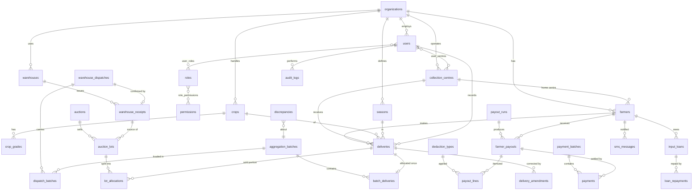

# AMCOS Produce Intake & Farmer Payment Tracking System — Architecture (Phase 1)

> Status: design document. Updated as the system evolves. Anything marked **[ASSUMPTION]** is a decision made without a confirmed cooperative requirement and can be revisited.

---

## 1. Architecture overview

The system is a **modular monolith**: one backend application, internally split into clear modules, plus one frontend app and one database. No microservices — one team, one deployment, and the strong transactional guarantees money handling needs.

```
 ┌──────────────────────────────┐        HTTPS / JSON (REST)        ┌──────────────────────────────┐        SQL (psycopg)        ┌──────────────┐
 │  Frontend (PWA)              │  ───────────────────────────────▶ │  Backend (FastAPI)           │  ─────────────────────────▶ │ PostgreSQL   │
 │  React + TS + Vite           │  ◀─────────────────────────────── │  API → Services → Repos      │  ◀───────────────────────── │ source of    │
 │  Service worker + IndexedDB  │      JWT access token             │  SQLAlchemy 2 + Alembic      │                             │ truth        │
 └──────────────────────────────┘                                   │  Adapters: SMS, Payments     │                             └──────────────┘
                                                                    └──────────────────────────────┘
```

| Layer | Responsibility | Must NOT do |
|---|---|---|
| **Frontend** | Display data, collect input, validate early (Zod) for good UX, cache what clerks need offline, queue offline deliveries | Be trusted. Hiding a button is not security. Never compute final money amounts. |
| **Backend** | Authenticate, authorize every request (RBAC), validate again (Pydantic), run business rules (net weight, payouts, workflow transitions), write audit logs, wrap multi-step changes in DB transactions | Put logic in endpoint functions; trust client totals |
| **Database** | Persist everything; enforce integrity with foreign keys, unique constraints, CHECK constraints, NUMERIC types | Hold business logic that's hard to test (we keep triggers minimal) |

Inside the backend, a request flows through layers:

```
HTTP request → api/v1/endpoints (parse, auth dependency) → services (business rules, transaction)
             → repositories (SQL queries) → models (tables) → PostgreSQL
```

Why layers: the payout calculation lives in one service function, so the API, a test, and a seed script all call the same code. No duplicated money logic.

---

## 2. End-to-end workflow: from farmer to payment

```
 1. Setup        Admin creates AMCOS, season, crops, collection centres, users; assigns clerk to centre
 2. Register     Clerk/manager registers Farmer (membership no., phone, village, centre)
 3. Deliver      Farmer brings produce. Clerk records Delivery: gross − tare = net weight
                 (offline OK → IndexedDB queue → sync later). Receipt number issued, SMS sent.
 4. Aggregate    Deliveries of the same crop/season/centre are grouped into an Aggregation Batch
                 (batch_deliveries rows keep each farmer's kg traceable)
 5. Dispatch     Batch(es) loaded onto a Warehouse Dispatch (vehicle, driver, dispatched kg)
 6. Receive      Warehouse Officer records Warehouse Receipt (received kg, rejected kg, receipt no.)
 7. Reconcile    System compares: Σ farmer net kg vs batch kg vs dispatched kg vs received kg.
                 Differences flagged as Discrepancies. Farmer records are NEVER auto-edited.
 8. Auction      Auction + Auction Lots (price per kg per lot/grade). Lot links to warehouse receipt/batch.
 9. Allocate     Sold kg is allocated back to each farmer's delivery, proportionally (see §9.3)
10. Calculate    Payout engine: gross = eligible kg × lot price; minus levies, loan repayments,
                 other deductions → net payable. Itemized lines stored. Status: calculated → approved.
11. Pay          Finance officer creates Payment Batch (draft) → different user approves → export
                 CSV/Excel for bank / mobile money → status "exported" (NOT paid)
12. Reconcile    Finance imports/enters actual results: paid / failed + transaction ref
13. Notify       SMS on delivery, on payment. Statement available on farmer profile / PDF.
14. Audit        Every step above writes an audit_logs row (who, what, before, after, when, why)
```

The key traceability chain, which every report is built on:

```
farmer → delivery → batch_delivery → aggregation_batch → dispatch → warehouse_receipt
       → auction_lot → lot_allocation (farmer's share of sold kg) → payout_line → payment
```

---

## 3. Modules and dependencies

Build order follows the arrows: a module only depends on modules above it.

```
Core: Organizations, Users/Roles/Permissions, Audit Log, Settings
  └─▶ Reference data: Seasons, Crops (units, grades), Collection Centres, Warehouses
        └─▶ Farmers
              └─▶ Deliveries (+ Receipts, Offline Sync)
                    └─▶ Aggregation Batches → Dispatch → Warehouse Receipts → Reconciliation
                          └─▶ Auctions & Lots → Allocations
                                └─▶ Deductions (Levies, Input Loans) → Payout Engine → Statements
                                      └─▶ Payment Batches → Export adapters → Reconciliation
  Cross-cutting (used by many): Notifications/SMS adapter, Reports, Dashboard, Audit
```

| # | Module | Depends on |
|---|---|---|
| 1 | Auth & users | organizations |
| 2 | Dashboard | everything (read-only aggregates) |
| 3 | Farmers | organizations, centres |
| 4 | Collection centres | organizations, users |
| 5 | Crops | organizations |
| 6 | Deliveries | farmers, centres, crops, seasons, users |
| 7 | Offline/sync | deliveries, farmers (cache) |
| 8 | Aggregation & warehouse | deliveries, warehouses |
| 9 | Auctions | warehouse receipts, batches |
| 10 | Payout engine | auctions, deductions, loans |
| 11 | Payments | payouts |
| 12 | SMS/notifications | farmers, deliveries, payments |
| 13 | Reports | everything |
| 14 | Audit | users (written by all modules) |
| 15 | Settings | organizations |

---

## 4. Database design

### 4.1 Why relational (PostgreSQL)

Our data is deeply connected (a payment traces back through 8 tables to a delivery) and money requires **ACID transactions**: approving a payment batch must update many rows all-or-nothing. PostgreSQL gives foreign keys, unique constraints, `NUMERIC` exact decimals, `CHECK` constraints, and powerful reporting SQL (`GROUP BY`, window functions). A document database would push all of that integrity work into our code.

### 4.2 Conventions

- **Primary keys:** `UUID` everywhere (`id uuid primary key`). Needed anyway because offline clients generate delivery IDs; also safe to expose in URLs.
- **Human references** separately: `receipt_no` like `MTW-2026-000123`, unique per organization. Generated server-side from a `number_sequences` table (row-locked), offline uses a provisional device-prefixed number (see §6).
- **Money:** `NUMERIC(14,2)` (TZS has no practical cents, but 2 decimals keeps us safe for other currencies). **Weights:** `NUMERIC(12,3)` kg. **Prices:** `NUMERIC(12,4)` per kg. Python uses `decimal.Decimal`, never `float`.
- **Timestamps:** `timestamptz`, stored in UTC, displayed in `Africa/Dar_es_Salaam`. Every table has `created_at`, `updated_at`; important ones have `created_by`.
- **Multi-tenancy:** most tables carry `organization_id` so one deployment can serve several AMCOS. Every query filters by the user's organization.
- **No hard deletes for business records.** Use `status` (e.g. `voided`) + reason. `ON DELETE RESTRICT` on financial foreign keys so the DB refuses accidental deletion.
- **Status columns** are `varchar` with a `CHECK` constraint (easier to migrate than native PG enums).

### 4.3 ER diagram



### 4.4 Tables (grouped)

**Identity & access**
| Table | Key columns | Notes |
|---|---|---|
| `organizations` | name, registration_no, region, district, currency (`TZS`), timezone, logo_path | The AMCOS |
| `users` | organization_id (nullable for system admin), email/username **unique**, full_name, phone, password_hash, is_active, last_login_at, failed_login_count, locked_until | Argon2/bcrypt hash only |
| `roles` / `permissions` | `code` unique (e.g. `delivery.create`, `payment_batch.approve`) | Seeded; permissions checked in backend |
| `user_roles`, `role_permissions`, `user_centres` | composite PKs | Many-to-many join tables |
| `refresh_tokens` | user_id, token_hash, expires_at, revoked_at, device_label | Session management / logout-everywhere |

**Reference data**
| Table | Notes |
|---|---|
| `seasons` | name `2026/27`, start/end date, is_active. Unique (org, name) |
| `crops` | name, code, default_unit (`kg`), is_active, `rules jsonb` (e.g. max tare %) |
| `crop_grades` | crop_id, code (`STD`, `UG`), description |
| `collection_centres` | code unique per org, name, village/ward/district/region, lat/lng, status |
| `warehouses` | name, operator, licence_no, location |

**Farmers**
`farmers`: organization_id, membership_no (**unique per org**), full_name, phone (indexed), gender (nullable), village, ward, district, region, home_centre_id, registration_date, status, notes, `payment_method` (`mobile_money`/`bank`/`cash`), `mobile_money_number`, `bank_name`, `bank_account_no`, `extra_fields jsonb` (configurable IDs). Trigram index on `full_name` for fast fuzzy search.

**Deliveries**
`deliveries`: **id = client-generated UUID** (idempotency key), organization_id, receipt_no (unique per org), farmer_id, centre_id, crop_id, grade_id, season_id, recorded_by, `gross_weight`, `tare_weight`, `net_weight` (CHECK `net_weight = gross_weight - tare_weight AND net_weight > 0`), unit, `captured_at` (device clock), `received_at` (server clock), `source` (`online`/`offline_sync`), device_id, status (`recorded`, `amended`, `voided`), void_reason, notes.
`delivery_amendments`: delivery_id, old values jsonb, new values jsonb, reason, requested_by, approved_by, status. Weight corrections go through this table; the original values remain visible forever.

**Aggregation & warehouse**
| Table | Notes |
|---|---|
| `aggregation_batches` | batch_no, crop, season, centre, total_net_weight (computed from members, stored at close), status `open→closed→dispatched→received→sold` |
| `batch_deliveries` | batch_id, delivery_id **UNIQUE** (a delivery can be in only one batch), net_weight snapshot |
| `warehouse_dispatches` | dispatch_no, warehouse_id, dispatch_date, vehicle_reg, driver_name, dispatched_weight, status |
| `dispatch_batches` | dispatch_id, batch_id, weight |
| `warehouse_receipts` | warehouse_id, dispatch_id, receipt_no (the warehouse's document no.), received_weight, rejected_weight, damaged_weight, receipt_date, document_path |
| `discrepancies` | stage (`batch→dispatch`, `dispatch→receipt`), expected, actual, difference, status `open/explained/approved`, reason, resolved_by |

**Auctions**
| Table | Notes |
|---|---|
| `auctions` | auction_ref, date, venue, crop, status `draft→approved` |
| `auction_lots` | auction_id, warehouse_receipt_id, lot_no, grade, quantity_sold, price_per_kg, total_value (CHECK = qty × price, rounded), unsold_quantity, buyer |
| `lot_allocations` | lot_id, delivery_id, allocated_weight, price_per_kg, gross_amount — the farmer's share of a lot |

**Deductions & loans**
| Table | Notes |
|---|---|
| `deduction_types` | code, name, `calc_method` (`fixed`, `percent_of_gross`, `per_kg`), rate, `applies_per` (`farmer`, `delivery`, `payout`), priority (order applied), crop_id/season_id (optional scope), effective_from/to, is_active |
| `input_loans` | farmer_id, loan_ref, issue_date, description (e.g. sulphur, pesticide), principal, terms, max_deduction_percent, status |
| `loan_repayments` | loan_id, amount, source (`payout`/`cash`), farmer_payout_id nullable, date |

Outstanding loan balance = principal − Σ repayments (computed, not stored, to avoid drift).

**Payouts**
| Table | Notes |
|---|---|
| `payout_runs` | season, crop, auction(s), status `draft→calculated→approved→superseded`, calculated_by, approved_by, timestamps |
| `farmer_payouts` | run_id, farmer_id, eligible_weight, gross_amount, total_deductions, net_payable, flags (`deductions_exceed_gross`), status |
| `payout_lines` | farmer_payout_id, line_type (`earning`, `levy`, `loan`, `other`), reference (lot, deduction_type, loan), quantity, rate, amount, description — **the itemized explanation** |

Recalculation creates a **new run** and marks the old one `superseded`; it never edits approved rows.

**Payments**
| Table | Notes |
|---|---|
| `payment_batches` | batch_no, method (`mobile_money`/`bank`), status `draft→awaiting_approval→approved→exported→processing→partially_completed/paid/failed`, prepared_by, approved_by (CHECK `approved_by <> prepared_by`), export_file_path |
| `payments` | batch_id, farmer_payout_id, amount, destination snapshot (phone/account at export time), status `pending/exported/paid/failed/reversed`, transaction_ref, paid_at, failure_reason. **Partial unique index**: one non-failed/non-reversed payment per farmer_payout → duplicate payment impossible at DB level |

**Notifications, sync, audit, settings**
| Table | Notes |
|---|---|
| `sms_templates` | code (`DELIVERY_RECEIPT`), language (sw/en), body with placeholders |
| `sms_messages` | farmer_id, phone, body, provider, provider_message_id, status `queued/sent/delivered/failed`, attempts, last_error |
| `sync_logs` | device_id, user_id, records_received, accepted, duplicates, rejected, details jsonb |
| `audit_logs` | user_id, action (`delivery.void`), entity_type, entity_id, before jsonb, after jsonb, reason, ip, created_at. App DB user gets **INSERT/SELECT only** on this table — no UPDATE/DELETE |
| `settings` | organization_id, key, value jsonb (receipt prefix, SMS on/off, etc.) |
| `number_sequences` | organization_id, sequence_key, next_value — for receipt/batch numbers |

### 4.5 Sample queries (preview)

```sql
-- Farmer search (name, membership number or phone)
SELECT id, membership_no, full_name, phone FROM farmers
WHERE organization_id = :org AND (full_name ILIKE '%' || :q || '%' OR membership_no = :q OR phone = :q)
LIMIT 20;

-- Daily collection per centre
SELECT c.name, d.captured_at::date AS day, SUM(d.net_weight) AS kg, COUNT(*) AS deliveries
FROM deliveries d JOIN collection_centres c ON c.id = d.centre_id
WHERE d.status <> 'voided' GROUP BY c.name, day ORDER BY day DESC;

-- Batch vs warehouse reconciliation
SELECT b.batch_no, b.total_net_weight, wr.received_weight,
       wr.received_weight - b.total_net_weight AS difference
FROM aggregation_batches b
JOIN dispatch_batches db ON db.batch_id = b.id
JOIN warehouse_receipts wr ON wr.dispatch_id = db.dispatch_id;
```

---

## 5. Folder structure

### Backend
```
backend/
  app/
    main.py                 # creates FastAPI app, registers routers, middleware, error handlers
    core/
      config.py             # settings from environment variables (pydantic-settings)
      security.py           # password hashing, JWT create/verify
      permissions.py        # permission codes + require_permission() dependency
      logging.py            # structured JSON logging
      exceptions.py         # domain errors → HTTP responses
    database/
      base.py               # SQLAlchemy DeclarativeBase + common mixins (id, timestamps)
      session.py            # engine, SessionLocal, get_db dependency
    models/                 # one file per area: farmer.py, delivery.py, payout.py ...
    schemas/                # Pydantic request/response models (FarmerCreate, FarmerRead ...)
    repositories/           # DB queries only (no business rules)
    services/               # business logic: delivery_service, payout_engine, sync_service ...
    integrations/
      sms/                  # base.py (interface), mock.py, africastalking.py (later)
      payments/             # base.py, csv_export.py (initial), provider adapters later
    api/v1/
      router.py
      endpoints/            # auth.py, farmers.py, deliveries.py, sync.py ...
    utils/                  # receipt numbers, pagination, pdf helpers
  alembic/                  # migrations (versions/*.py)
  scripts/                  # create_admin.py, seed_dev.py
  tests/                    # unit/, api/
  pyproject.toml / requirements.txt, Dockerfile, .env.example
```

### Frontend
```
frontend/
  src/
    api/          # axios/fetch client, typed endpoint functions
    components/   # shared UI: Button, DataTable, StatusBadge, ConfirmDialog
    layouts/      # AppLayout (sidebar + header), AuthLayout
    features/     # one folder per module: auth/, farmers/, deliveries/, payments/ ...
                  #   each has components/, hooks/, schemas.ts (Zod), api.ts
    offline/      # IndexedDB (Dexie), sync queue, sync engine
    pages/        # route-level screens composed from features
    routes/       # router config, ProtectedRoute, permission guards
    context/      # AuthContext, OnlineStatusContext
    hooks/, types/, utils/, styles/
  public/         # PWA icons, manifest
  vite.config.ts  # includes vite-plugin-pwa (service worker)
```

Component library: **shadcn/ui** (Radix primitives + Tailwind; code is copied into our repo, accessible, professional look). Charts: **Recharts**. Tables: **TanStack Table**. IndexedDB wrapper: **Dexie** (much simpler than the raw IndexedDB API).

---

## 6. Offline-first architecture

```
 Clerk's phone (PWA)                                           Server
 ┌──────────────────────────────────────────┐
 │ Service worker: caches app shell (HTML,  │
 │ JS, CSS) → app opens with no internet    │
 │                                          │
 │ IndexedDB (Dexie)                        │
 │  • farmers_cache  (id, name, member no., │        GET /sync/farmers?centre=..&since=..
 │    phone) for assigned centres only  ◀───┼──────── (delta download when online)
 │  • crops, seasons, centre info           │
 │  • outbox_deliveries                     │        POST /sync/deliveries  [batch]
 │    {id: uuid, ..., status: pending}  ────┼──────▶ for each record:
 │                                          │          id exists & identical → "duplicate" (OK)
 │  status: pending → syncing → synced      │          id exists & different → "conflict" (flag, no overwrite)
 │                  ↘ failed (retry/view)   │          valid → INSERT, assign official receipt_no
 └──────────────────────────────────────────┘        ◀── per-record result {id, status, receipt_no}
```

Rules:
1. **Client generates the UUID** (`crypto.randomUUID()`) at capture time. That UUID is the delivery's primary key → retrying the same upload can never create a second row (**idempotency**).
2. A record is `synced` **only when the server returns a per-record acknowledgement**, never just because the network is up.
3. Server computes net weight again and validates everything; server is authoritative.
4. Conflicts (same id, different content) go to a `conflict` state for a manager to resolve — never silently overwritten.
5. Store both `captured_at` (device) and `received_at` (server). Large clock differences are flagged.
6. **Receipt numbers offline:** the device issues a provisional number `OFF-<deviceCode>-<seq>` printed on the receipt; on sync the server assigns the official number and links both (the UUID-based verification reference stays the same, so the farmer's receipt remains verifiable).
7. Sync triggers: app start, `online` event, every few minutes while online, and a manual "Sync now" button. Exponential backoff on failures.

**Offline authentication — security model and limitations**
- The user must log in **online at least once** on the device. We get a short-lived access token + a refresh token.
- Offline, the app allows use while a locally stored "offline session" is valid (e.g. up to **72 hours** since last online login **[ASSUMPTION]**, configurable) and only for the *clerk intake* functions. A local PIN can lock the app screen.
- **We never store the password** on the device. We store only the minimum: cached farmer lookup fields (name, membership no., phone), crops, and the clerk's own unsynced deliveries. No payout amounts, loan balances or bank details offline.
- Limitation to understand: anything in the browser can be read by someone with the unlocked device. Offline "login" is a convenience lock, not real authentication — real authorization happens when records reach the server, which re-checks that the token's user is allowed to record deliveries at that centre.

---

## 7. Docker architecture

```
            your browser (http://localhost:5173 , http://localhost:8000/docs)
                         │                     │
   ┌─────────── docker network: amcos_net ─────┼──────────────────────┐
   │   ┌────────────┐        ┌────────────┐            ┌────────────┐ │
   │   │ frontend   │ ─────▶ │ backend    │ ────────▶  │ db         │ │
   │   │ Vite dev   │  /api  │ uvicorn    │ host "db"  │ postgres:17│ │
   │   │ :5173      │ proxy  │ :8000      │ port 5432  │ :5432      │ │
   │   └────────────┘        └────────────┘            └─────┬──────┘ │
   └─────────────────────────────────────────────────────────┼────────┘
                                                             │
                                          named volume: amcos_pgdata (survives restarts)
```

- Containers on the same Compose network find each other by **service name**: the backend connects to `db:5432`, not `localhost` (inside a container, `localhost` means *that container itself*).
- The browser runs on your machine, so it uses published ports (`localhost:5173`). Vite proxies `/api` to `http://backend:8000`, avoiding CORS issues in development.
- `db` has a healthcheck (`pg_isready`); backend uses `depends_on: condition: service_healthy`.
- Source code is **bind-mounted** in development so edits reload instantly; production builds bake code into images and serve the frontend as static files via Nginx.

Docker fundamentals are taught step by step in `docs/DOCKER_GUIDE.md` during Phase 2.

---

## 8. Roadmap & milestones

| Phase | Milestone (definition of done) |
|---|---|
| 1 | This document reviewed ✅ |
| 2 | `docker compose up --build` starts frontend + backend + db; `/api/v1/health` reports DB connected; frontend shows it |
| 3 | Core models + Alembic migrations applied; seed script; tables inspected with `psql` |
| 4 | Login, JWT refresh, RBAC enforced in API with tests; app layout + sidebar + protected routes |
| 5 | Org, centres, crops, farmers CRUD; delivery intake with receipts (PDF); offline capture + sync with idempotency tests |
| 6 | Batches, dispatch, warehouse receipts, reconciliation & discrepancies; auctions, lots, allocations |
| 7 | Levies, loans, payout engine with worked examples & unit tests; statements; payment batches, maker-checker, CSV/Excel export, result reconciliation |
| 8 | SMS adapter (mock + one real provider), templates, retry queue; reports (PDF/Excel/CSV); audit log viewer; dashboard |
| 9 | End-to-end scenario tests (offline, duplicates, discrepancies, partial payment failures, unauthorized calls) |
| 10 | README, env docs, DB docs, API docs, backup/restore, deployment guide |

---

## 9. Key technical decisions & challenges

1. **UUID primary keys** — required for offline creation; slightly larger indexes, acceptable.
2. **JWT access token (15 min) in memory + refresh token (httpOnly cookie, rotated, stored hashed in DB)** — avoids storing long-lived tokens in localStorage (XSS risk) and allows server-side revocation/logout.
3. **Sold-quantity allocation (the hardest business rule).** A batch of 5,000 kg from 40 farmers may arrive as 4,950 kg at the warehouse and be sold in 2 lots at different prices. **[ASSUMPTION — to confirm with a real AMCOS]** Default policy: each farmer's eligible weight = their net kg × (batch sold kg ÷ batch delivered kg), and each lot's price is applied pro-rata across the batch's farmers. Warehouse loss is therefore shared proportionally. The policy is stored per payout run so it's explicit and auditable; alternative policies (e.g. pay on delivered kg, AMCOS absorbs loss) can be added as options.
4. **Rounding.** Compute with full `Decimal` precision, round each payout line to 2 dp with `ROUND_HALF_UP`, and store per-line amounts so totals are reproducible. Lot-level rounding remainders are recorded explicitly, not lost.
5. **Deductions exceeding gross.** Levies applied first (priority order), then loan repayments capped at the remaining amount (and loan's max %), then others. If still negative → payout flagged `needs_review`, net set to 0, nothing paid until a manager decides.
6. **Maker–checker** for payment batches enforced in service *and* by a DB CHECK constraint.
7. **Audit log immutability** via DB privileges (separate migration role vs app role).
8. **Concurrency** — receipt/batch numbers use `SELECT ... FOR UPDATE` on `number_sequences`; approving workflows check current status inside the transaction (optimistic: `UPDATE ... WHERE status = 'awaiting_approval'`).
9. **SMS & payments are adapters**; dev uses a mock that *records* messages/exports with status clearly marked `simulated`. No WRRB/TMX integration is assumed.
10. **Risks:** device clock errors, shared phones between clerks, lost devices with unsynced data (mitigate: sync often, show unsynced count prominently), browser storage eviction (request `navigator.storage.persist()`), and Swahili language support (plan i18n from the start — **[ASSUMPTION]** English first, Swahili strings added in Phase 8).
